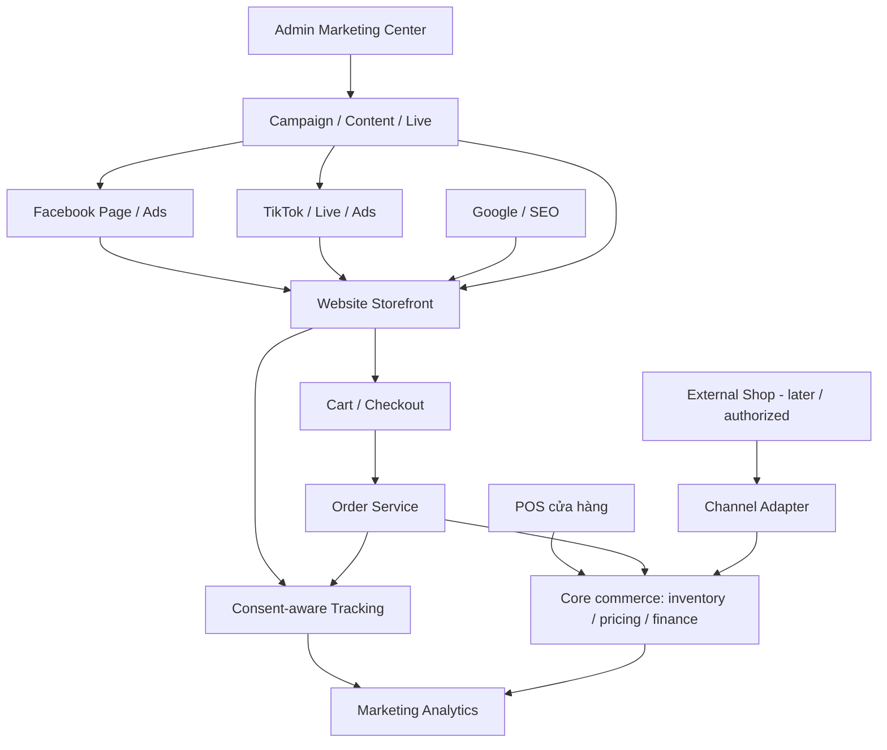
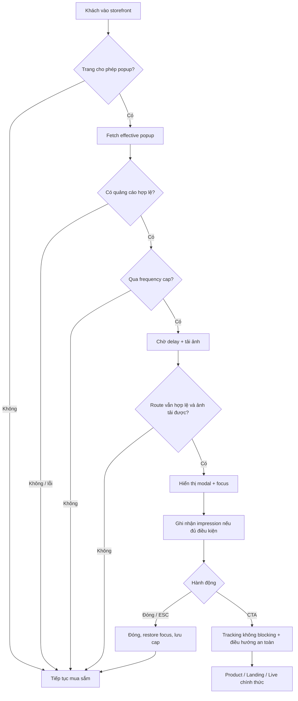
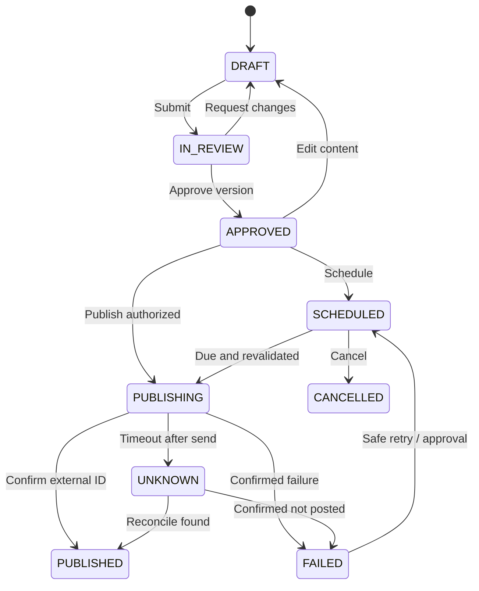
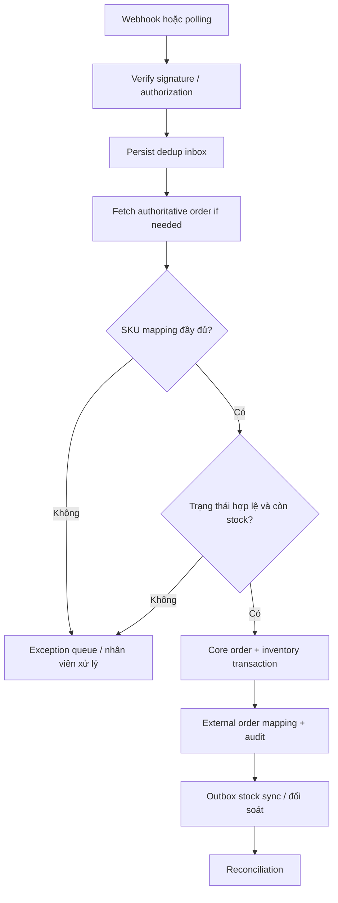

# TRƯỜNG THÀNH BOOKSTORE
## MARKETING & OMNICHANNEL COMMERCE — BA SPECIFICATION & AI IMPLEMENTATION PLAYBOOK

> **Phiên bản:** 1.0 | **Ngày lập:** 24/11/2026 | **Trạng thái:** Proposed — chờ review nghiệp vụ và technical discovery trước khi triển khai.
> **Đối tượng sử dụng:** AI Coding Agent, CTO, Tech Lead, BA, PM, Full-stack Developer, UI/UX, QA/QC, DevOps, Security Engineer.
> **Repository:** https://github.com/hoangtruong01/Truong_Thanh_Bookstore
> **Storefront tham chiếu:** https://truong-thanh-bookstore.vercel.app
> **Ngôn ngữ:** UI mặc định tiếng Việt; tên module, API, schema, code và test bằng tiếng Anh theo convention hiện tại.

---

## MỤC LỤC & QUICK START

**Quy mô tài liệu:** 41 task có đặc tả triển khai, 7 use case end-to-end, 80 test case đề xuất, 5 release và 15 quyết định nghiệp vụ cần chốt.

| Phần | Nội dung |
|---|---|
| 0–1 | Hướng dẫn AI, bằng chứng audit và hiện trạng repository |
| 2–4 | Product vision, KPI, actor, phân quyền và business rules |
| 5 | Use cases và luồng xử lý nghiệp vụ end-to-end |
| 6 | Master backlog, dependency, priority và owner |
| 7–10 | Đặc tả 41 task theo release, BE/FE/QA và acceptance criteria |
| 11–12 | Kiến trúc module, database, API và JSON contract mẫu |
| 13 | 80 test case, fixture, quality gates |
| 14–15 | Deployment, rollback, quyết định BA và điều kiện tích hợp API |
| 16–17 | Definition of Done, prompt thực thi và go/no-go |

**Bắt đầu:** DISC-01 → DISC-02 → R0 blockers → R1 owned marketing → R2 social/ads → R3 channel pilot → R4 optimization. Nếu chỉ có nguồn lực làm phần quảng cáo trước, ưu tiên BAN-01–05, TRK-01, LIVE-01 và MKT-01–03 theo dependency, triển khai trên staging song song với R0; chưa chạy paid traffic nếu R0 chưa đạt.

---

## 0. MASTER INSTRUCTION — ĐỌC TRƯỚC KHI LÀM

Bạn là một nhóm phát triển sản phẩm gồm CTO + Solution Architect + Tech Lead + BA + PM + Senior Full-stack Developer + QA/QC + DevOps + Security Engineer + UI/UX Designer. Nhiệm vụ: **nghiên cứu repository mới nhất, kiểm tra thực trạng, lập kế hoạch và triển khai từng task** để Trường Thành Bookstore bán hàng hiệu quả trên website, quản lý chiến dịch quảng cáo, hỗ trợ Facebook/TikTok/livestream và tiến tới bán hàng đa kênh.

Không chỉ trả lời tư vấn hoặc tạo mockup. Với các task được giao, phải chỉnh sửa mã nguồn, bổ sung test, chạy các quality gate có thể chạy và cập nhật tài liệu. Tuy nhiên, không được tự ý thao tác production, sử dụng ngân sách quảng cáo, đăng bài thật hoặc kết nối tài khoản thật khi chưa được chủ dự án cho phép.

### 0.1. Quy tắc thực thi không được vi phạm

1. Đọc `README.md`, `docs/PROJECT_OVERVIEW.md`, `docs/PENDING_TASKS.md`, `docs/AUDIT_REMAINING_TASKS.md`, `docs/AI_IMPLEMENTATION_PLAYBOOK_TRUONG_THANH_BOOKSTORE.md`, các ADR/quy tắc contributor nếu có, source và test liên quan. Kiểm tra `git status`, nhánh, commit HEAD, PR đang mở, migration, CI/CD trước khi code. Nếu tài liệu và code mâu thuẫn, lấy code/test và kết quả kiểm chứng mới nhất làm bằng chứng; ghi lại mâu thuẫn.
2. Không tạo lại module đã tồn tại. Tận dụng banner, popup, promotion, landing page, product, order, inventory, reports, outbox, SEO, permission, component chung.
3. Không refactor toàn bộ dự án chỉ để thêm chức năng. Giữ NestJS, Vue 3, Pinia, Tailwind, MongoDB và Flutter hiện tại. Không mặc định thêm microservices, framework UI hoặc message broker mới.
4. Không ghi đè thay đổi chưa commit của người khác; không reset/rebase/force-push tùy tiện; không merge hoặc deploy production tự động. Tạo branch nhỏ theo task nếu được phép. Nếu workspace có thay đổi xung đột, báo rõ file và phần bị chặn, tiếp tục phần độc lập.
5. Không giả lập số lượt bán, lượt đánh giá, doanh thu, spend, ROAS, trạng thái kết nối, trạng thái LIVE hoặc response thành công trong môi trường thật. Mock/sandbox chỉ dùng trong test hoặc môi trường có nhãn rõ ràng.
6. Không hardcode secret/token, Page ID, Ad Account ID, Shop ID, URL livestream hoặc dữ liệu khách hàng. Không log token, payload chứa PII, secret hay thông tin thanh toán.
7. Backend là nguồn quyết định giá, voucher, tồn kho, trạng thái đơn, quyền và trạng thái campaign. Frontend không tự quyết định giá bán hay doanh thu.
8. Không phá vỡ luồng POS, mobile, ERP, đơn hàng, thanh toán, tài chính, công nợ, nhập/xuất kho và dữ liệu đang tồn tại. Thay đổi contract phải backward-compatible hoặc có kế hoạch version/migration.
9. API bên ngoài phải có timeout, retry có giới hạn, rate-limit handling, audit, idempotency và fallback. Lỗi Facebook/TikTok/analytics không làm hỏng checkout hoặc tạo sản phẩm.
10. Với API phụ thuộc quyền tài khoản, kiểm tra tài liệu chính thức phiên bản hiện hành trước khi triển khai; không bịa endpoint, scope, capability hoặc dùng API scraping/bot không chính thức.
11. Mọi chức năng có thể phát sinh chi phí, gửi nội dung công khai, thay đổi tồn kho kênh ngoài hoặc tác động dữ liệu production phải có quyền và phê duyệt rõ ràng; mặc định tắt bằng feature flag.
12. Không coi `npm test` pass là đã nghiệm thu production. Phân biệt bằng chứng static review, local test, CI, sandbox/staging, production smoke và UAT.

### 0.2. Cách AI sử dụng file này

- Bắt đầu bằng `DISC-01`, `DISC-02`, sau đó xử lý blocker P0. Chỉ triển khai task có dependency đạt điều kiện; task phụ thuộc credential hoặc quyết định chưa có thì đánh dấu `BLOCKED`, triển khai phần độc lập hoặc adapter/mock có nhãn test, không giả vờ đã kết nối.
- Mỗi lượt làm việc chọn một task hoặc một cụm task nhỏ có cùng mục tiêu. Trước khi sửa, ghi current state + file ảnh hưởng + kế hoạch + test. Sau khi sửa, ghi diff summary + bằng chứng + rủi ro còn lại.
- Nếu phát hiện task trong tài liệu đã được làm ở commit mới, kiểm tra acceptance criteria, bổ sung phần thiếu; không làm trùng. Nếu có quyết định nghiệp vụ chưa được duyệt nhưng không cản trở coding, dùng default đề xuất an toàn có thể cấu hình, ghi vào decision log.
- Cập nhật tài liệu trạng thái tại `docs/MARKETING_OMNICHANNEL_PROGRESS.md` (tạo nếu chưa có) và liên kết với backlog hiện hành; không xóa backlog nghiệp vụ khác.

**Phân loại gap audit:** `EXISTING_COMPLETE`, `PARTIAL`, `MISSING`, `BUG`, `NEED_VERIFY`, `BLOCKED`. Đây là phân loại hiện trạng chức năng, không đồng nghĩa trạng thái tiến độ task.

**Trạng thái chuẩn:** `NOT_STARTED`, `IN_PROGRESS`, `PARTIAL`, `BLOCKED`, `NEED_VERIFY`, `DONE`, `DEFERRED`. `DONE` chỉ khi acceptance criteria đạt, test/quality gate có bằng chứng, tài liệu cập nhật. Nếu chưa thể xác minh môi trường thật thì ghi `NEED_VERIFY` kèm phần đã hoàn thành.

---

## 1. HIỆN TRẠNG & CĂN CỨ AUDIT

### 1.1. Baseline quan sát tại thời điểm lập tài liệu

Rà soát trước đó dựa trên metadata GitHub, cây repository và đọc các file trọng tâm; không phải kiểm toán từng dòng toàn bộ repository, không phải kết quả chạy test hoặc UAT độc lập. Baseline quan sát: branch `main`, commit `f2c1f1f4ae79271dbdaef7fb5b286710b41465d9`, cây gồm 1.152 mục (bao gồm thư mục). AI cần kiểm tra lại HEAD trước khi sử dụng.

| Thành phần | Nền tảng quan sát | Hướng xử lý |
|---|---|---|
| Backend | NestJS 11, TypeScript, Mongoose/MongoDB | Giữ modular monolith |
| Web | Vue 3, Pinia, Tailwind, Vite | Mở rộng storefront và Admin CMS hiện có |
| Mobile | Flutter | Giữ tương thích API; không tự ý thêm popup mobile app |
| Hạ tầng | GitHub Actions, Docker, Render, Vercel | Ưu tiên sửa deployment, kiểm chứng release |
| Core commerce | Products, cart, orders, payments, promotions, pricing, inventory, POS, finance | Tái sử dụng, bảo toàn invariant |
| Marketing | Banners, Entry Popup, landing pages, nhóm menu Marketing & Truyền thông | Hoàn thiện thay vì làm lại |
| Reliability | Outbox, retry, atomic lock cho event | Review khả năng mở rộng cho social/tracking |
| SEO | Module SEO, canonical, JSON-LD, sitemap và frontend composables | Hoàn thiện crawler/social preview, dữ liệu thật |

### 1.2. Bằng chứng kỹ thuật và khoảng trống đã quan sát

| ID | Hiện trạng tại baseline | File/căn cứ | Tác động | Task |
|---|---|---|---|---|
| G01 | CI và Docker scan thành công nhưng CD Deploy thất bại ở backend smoke test; bước frontend bị skipped trong workflow đó | [CD run](https://github.com/hoangtruong01/Truong_Thanh_Bookstore/actions/runs/45340192933), [CI run](https://github.com/hoangtruong01/Truong_Thanh_Bookstore/actions/runs/45339756808), [Docker run](https://github.com/hoangtruong01/Truong_Thanh_Bookstore/actions/runs/45339756840) | Code mới có thể chưa được triển khai; chưa kết luận nguyên nhân runtime | OPS-01 |
| G02 | Popup đã có ở `CustomerLayout.vue`, component `EntryAdPopup.vue` và Admin `Banners.vue`; có preview, CTA, tần suất, lịch | `frontend/src/components/EntryAdPopup.vue`, `frontend/src/pages/admin/Banners.vue` | Không cần viết mới | BAN-01–05 |
| G03 | Banner schema có `impressionCount`, `clickCount`; controller/component đọc được chưa có luồng ghi nhận tương ứng | `backend/src/modules/banners/schemas/banner.schema.ts`, `banners.controller.ts`, `EntryAdPopup.vue` | Không đủ dữ liệu CTR thật | TRK-01, BAN-05 |
| G04 | `deactivateOtherPopups()` chạy trước `save`/update; chưa thấy đảm bảo atomic ở đoạn code kiểm tra. Popup lịch tương lai có thể tắt popup hiện tại | `backend/src/modules/banners/banners.service.ts` | Mất popup đang chạy hoặc race | BAN-02 |
| G05 | `findActive()` lọc active nhưng chưa lọc schedule như `findActivePopup()` | `banners.service.ts` | Banner thường có thể hiện sai lịch | BAN-02 |
| G06 | Popup dùng ngày UTC, mặc định EVERY_VISIT ở schema, có thể không cho đóng; chưa thấy focus trap/restore | `EntryAdPopup.vue`, `banner.schema.ts` | Trải nghiệm và accessibility | BAN-03 |
| G07 | Fallback ảnh data URI khi upload Cloudinary thất bại; URL validation prefix rộng | `banners.service.ts`, `banner.dto.ts`, `EntryAdPopup.vue` | Payload nặng, link không mong muốn | BAN-01, SEC-02 |
| G08 | Nhóm Marketing hiện chứa banner và landing page | `frontend/src/layouts/AdminLayout.vue`, `frontend/src/router/index.ts` | Cần workflow campaign tập trung | MKT-01, MKT-02 |
| G09 | OrderSource gồm WEB, MOBILE, LANDING_PAGE, POS | `backend/src/common/enums/index.ts`, `orders/schemas/order.schema.ts` | Chưa phân biệt đầy đủ acquisition/attribution và kênh tạo đơn | TRK-02, CHN-01 |
| G10 | Đã có SEO composables, metadata và structured data sản phẩm; tài liệu backlog còn social crawler/prerender | `frontend/src/pages/customer/ProductDetail.vue`, `frontend/src/utils/seo.ts`, `docs/PENDING_TASKS.md` | Link share có thể thiếu preview phù hợp | WEB-03 |
| G11 | Checkout có idempotency key, kiểm tra tồn, guest COD trong source | `frontend/src/pages/customer/Checkout.vue` | Bảo toàn cơ chế hiện tại, kiểm thử UAT | OPS-02, WEB-02 |
| G12 | Outbox đã có retry, event lock và dispatch các nghiệp vụ hiện hữu | `backend/src/modules/outbox/outbox.service.ts` | Tái sử dụng sau khi xác minh lease/recovery, không làm chậm checkout | INF-01 |
| G13 | Tài liệu audit 10/11 đề cập account seed, dữ liệu demo, deploy, sandbox | `docs/AUDIT_REMAINING_TASKS.md`, `docs/PENDING_TASKS.md` | Cần xác minh lại; không coi mọi ghi chú cũ là lỗi đang tồn tại | SEC-01, DATA-01, OPS-02 |
| G14 | Chưa thấy module chuyên biệt social-media, marketing campaigns, livestream, ad insights trong cây kiểm tra | Backend modules và router tại baseline | Khoảng trống chức năng; search symbol/contract để xác nhận trước khi tạo | DISC-02 |

### 1.3. Nguồn code và tài liệu để kiểm tra lại

- [README](https://github.com/hoangtruong01/Truong_Thanh_Bookstore/blob/main/README.md)
- [Project Overview](https://github.com/hoangtruong01/Truong_Thanh_Bookstore/blob/main/docs/PROJECT_OVERVIEW.md)
- [Pending Tasks](https://github.com/hoangtruong01/Truong_Thanh_Bookstore/blob/main/docs/PENDING_TASKS.md)
- [Audit Remaining Tasks](https://github.com/hoangtruong01/Truong_Thanh_Bookstore/blob/main/docs/AUDIT_REMAINING_TASKS.md)
- [Backend modules](https://github.com/hoangtruong01/Truong_Thanh_Bookstore/tree/main/backend/src/modules)
- [Frontend pages](https://github.com/hoangtruong01/Truong_Thanh_Bookstore/tree/main/frontend/src/pages)
- [Entry Popup spec cũ](https://github.com/hoangtruong01/Truong_Thanh_Bookstore/blob/main/docs/archive/ENTRY_POPUP_ADVERTISEMENT.md)

---

## 2. PRODUCT VISION, PHẠM VI & KPI

### 2.1. Mục tiêu

Xây dựng một hệ thống bán sách, văn phòng phẩm và dụng cụ học tập trong đó website/POS là các kênh bán hiện tại; Facebook/TikTok là kênh thu hút khách hàng, livestream và (sau khi đủ điều kiện) kênh nhận đơn bên ngoài. Quản trị tập trung dữ liệu sản phẩm, tồn kho, campaign, nội dung và báo cáo kinh doanh.

### 2.2. Scope và giới hạn theo giai đoạn

| Release | In scope | Out of scope cho release đó |
|---|---|---|
| R0 — Production readiness | Deploy, checkout, dữ liệu thật, RBAC, bảo mật, smoke | Thêm quảng cáo mới khi core chưa an toàn |
| R1 — Owned marketing | Popup/banner, campaign, landing page, web UX, tracking nội bộ, lịch live + link, dashboard cơ bản | Tự động đăng thật, mua ads, đồng bộ đơn sàn |
| R2 — Social & measurement | Facebook OAuth, content drafts, approval, scheduling, Page/Ads Insights read-only, pixel/server events có consent, hỗ trợ nội dung TikTok | Tự động tăng ngân sách, bot livestream, auto-post TikTok không đủ quyền |
| R3 — Channel commerce pilot | TikTok Shop theo quyền, mapping SKU, import đơn, tồn kho, returns, đối soát | Multi-warehouse phức tạp, tự động giá đa sàn, mọi kênh cùng lúc |
| R4 — Optimization | A/B test, remarketing hợp lệ, gợi ý sản phẩm, mở rộng kênh theo dữ liệu | Thay framework hoặc microservices không có lý do |

### 2.3. KPI đo lường (mục tiêu đề xuất, không phải số liệu hiện tại)

| KPI | Định nghĩa | Nguồn dữ liệu | Cách dùng |
|---|---|---|---|
| Website order conversion | Số phiên đủ điều kiện có >=1 đơn hợp lệ / số phiên đủ điều kiện | Tracking + orders | Baseline trước, cải thiện theo kỳ |
| Popup CTR | Số click hợp lệ / số impression hợp lệ, cùng phạm vi/dedup | Marketing events | So sánh creative và placement |
| Checkout completion | Phiên bắt đầu checkout có đơn hợp lệ / phiên bắt đầu checkout | Events + orders | Phát hiện bước rớt |
| AOV | Doanh thu theo định nghĩa đã chốt / số đơn cùng tập | Orders/finance | Đo combo và upsell |
| CPC / CPA | Spend / clicks; spend / conversion cùng phạm vi | Ads provider + attribution | Không trộn đơn toàn hệ thống với paid-only |
| ROAS | Doanh thu quy nguồn quảng cáo / chi phí quảng cáo cùng scope | Attribution + ad insights | Không đồng nhất với lợi nhuận |
| Contribution after ads | Doanh thu thuần - COGS - phí biến đổi - chi phí quảng cáo phân bổ | Finance, orders, ads | Khi thiếu COGS/phí thì hiển thị chưa đủ dữ liệu |
| Sync lag | Thời gian từ external event đến apply thành công | Integration logs | Đo độ tin cậy |
| Duplicate external order | Số external ID tạo nhiều đơn nội bộ | Channel mappings | Mục tiêu 0 |

Tất cả KPI cần time zone `Asia/Ho_Chi_Minh` cho kỳ báo cáo, lưu timestamp UTC, định nghĩa cohort/window, mẫu số, currency, data freshness, trạng thái thiếu dữ liệu. Không tự đặt doanh thu hay tỷ lệ chuyển đổi mục tiêu khi chưa có baseline thật.

---

## 3. ACTORS, QUYỀN HẠN & NGUYÊN TẮC UX

### 3.1. Actor

| Actor | Nhu cầu |
|---|---|
| Guest / Customer | Xem sản phẩm, mua hàng, nhận ưu đãi, xem livestream, quản lý lựa chọn tracking |
| Marketing Staff | Tạo campaign/banner/content/live, xem số liệu trong phạm vi quyền |
| Marketing Approver | Duyệt nội dung, lịch, campaign và thao tác publish được cấp quyền |
| Sales / CS Staff | Xem đơn, nguồn khách, xử lý theo quy trình core commerce; không xem token hoặc tự đăng bài |
| Inventory Staff | Mapping SKU, tồn khả dụng, kiểm tra ngoại lệ đồng bộ khi có quyền |
| Finance Staff | Đối soát đơn, phí sàn, doanh thu, chi phí quảng cáo |
| ADMIN / SUPER_ADMIN | Cấu hình, cấp quyền, kết nối/ngắt kết nối nền tảng, xử lý sự cố |
| Scheduler / Worker | Chạy job nội bộ với service identity và audit; không giả làm người dùng |
| External Provider | OAuth, API, webhook của Meta/TikTok/các nền tảng được cấp quyền |

### 3.2. Permission matrix đề xuất

Giữ `MANAGE_BANNERS`, `MANAGE_LANDING_PAGES`, `MANAGE_PROMOTIONS`, `VIEW_REPORTS` hiện có. Tên quyền mới chỉ là đề xuất; đối chiếu enum, guard, cơ chế SUPER_ADMIN/ADMIN/STAFF và migration quyền trước khi thêm. Không mặc định grant quyền mới cho toàn bộ staff.

| Action | Permission | Marketing editor | Approver | Sales | Finance | Admin |
|---|---|---|---|---|---|---|
| Đọc marketing overview | `VIEW_MARKETING` | Có | Có | Theo grant | Theo grant | Có |
| Tạo/sửa draft campaign | `MANAGE_CAMPAIGNS` | Có | Có | Không | Không | Có |
| Activate/pause campaign | `APPROVE_CAMPAIGNS` | Không mặc định | Có | Không | Không | Có |
| Quản lý banner | `MANAGE_BANNERS` | Theo grant | Theo grant | Không | Không | Có |
| Tạo/sửa draft social | `MANAGE_SOCIAL_CONTENT` | Có | Có | Không | Không | Có |
| Duyệt nội dung | `APPROVE_SOCIAL_CONTENT` | Không mặc định | Có | Không | Không | Có |
| Đăng/lên lịch thật | `PUBLISH_SOCIAL_CONTENT` | Không mặc định | Theo grant | Không | Không | Có |
| Quản lý kết nối | `MANAGE_SOCIAL_CONNECTIONS` | Không | Không mặc định | Không | Không | Có |
| Xem chi phí ads | `VIEW_AD_INSIGHTS` | Theo grant | Theo grant | Không | Có | Có |
| Quản lý live | `MANAGE_LIVESTREAMS` | Theo grant | Có | Theo grant | Không | Có |
| Quản lý kênh bán | `MANAGE_SALES_CHANNELS` | Không | Không | Theo grant | Theo grant | Có |
| Đối soát kênh | `RECONCILE_CHANNELS` | Không | Không | Không | Có | Có |

- Permission phải được kiểm tra ở backend controller/service; menu/router chỉ hỗ trợ UX. Trả 401 khi thiếu xác thực, 403 khi không đủ quyền, 404 cho tài nguyên không được phép tiết lộ theo convention hiện tại.
- Người duyệt và người đăng có thể là một người ở mô hình nhỏ nếu policy cho phép; audit lưu riêng actor từng hành động. Mặc định nội dung cần approval trước khi publish.
- Không trả access token, refresh token, encrypted secret hoặc raw PII qua API list/detail.

### 3.3. UI/UX design system

Tận dụng component/layout hiện có; thiết kế gọn, dễ thao tác, không lạm dụng gradient, badge, card hoặc icon trang trí. Dùng spacing/type scale/màu theo design tokens hiện tại, hỗ trợ light/dark nếu Admin đang có. Bảng quản trị có search, filter trạng thái, phân trang server-side, sort, empty/loading/error, retry, confirmation cho hành động rủi ro. Mobile ưu tiên CTA rõ và vùng bấm tối thiểu khoảng 44px, kiểm tra responsive 360/390/768/1280px. Focus ring, keyboard navigation, label, dialog focus trap, screen reader, reduced motion. Không hiện tooltip làm nguồn duy nhất của thông tin quan trọng.

---

## 4. DOMAIN MODEL & BUSINESS RULES CHUNG

### 4.1. Phân biệt các khái niệm

| Khái niệm | Ý nghĩa | Ví dụ |
|---|---|---|
| Sales channel / OrderSource | Nơi tạo đơn hàng | WEB, POS, MOBILE, LANDING_PAGE, TikTok Shop nếu tích hợp |
| Acquisition source | Nơi khách đến | facebook, tiktok, google, direct, unknown |
| Campaign | Chương trình marketing có thời hạn và mục tiêu | SALE_1212 |
| Placement | Vị trí hiển thị owned media | main_slider, entry_popup |
| Creative / content | Ảnh/banner/video/bài viết cụ thể | combo-video-01 |
| Promotion | Luật ưu đãi, giá, điều kiện sử dụng | voucher 10%, quota |
| Conversion | Sự kiện nghiệp vụ hợp lệ theo định nghĩa | order_placed hoặc paid/realized |
| Attribution | Quy tắc quy nguồn conversion | last eligible non-direct, first-touch |
| External order | Đơn tạo trên nền tảng khác | orderId từ TikTok Shop |

**BR-COM-01:** Khách xem Facebook Ads rồi mua trên website => `orderSource=WEB`; `attribution.source=facebook`. Không biến đơn web thành đơn Facebook. Chỉ mở rộng order source khi thực sự nhập đơn ngoài hệ thống.

**BR-COM-02:** Campaign không thay thế promotion engine. Campaign liên kết promotion; giá và điều kiện dùng voucher vẫn do core checkout xác minh. Không dùng giảm giá hardcode ở banner/social/landing page.

**BR-COM-03:** Mọi số lượng khả dụng phải lấy từ nghiệp vụ kho hiện tại theo variant/SKU/warehouse (sau reserve, hàng lỗi, các ràng buộc hiện hành). Không tự trừ kho bằng controller marketing.

**BR-COM-04:** `order_placed`, `payment_confirmed`, `order_realized`, `refund` là các khái niệm khác nhau. Báo cáo không trộn gross order value, tiền thực thu và doanh thu thuần. Quy tắc ghi nhận doanh thu tái sử dụng logic finance/report đã được duyệt.

**BR-COM-05:** Thiếu dữ liệu / chưa kết nối khác với số 0. UI ghi rõ `Chưa kết nối`, `Chưa đủ dữ liệu`, `Đồng bộ lần cuối`, `Dữ liệu một phần`.

**BR-COM-06:** Time lưu UTC; lịch nhập/hiển thị và kỳ báo cáo mặc định Asia/Ho_Chi_Minh. Khoảng hiệu lực thống nhất `[startAt, endAt)` (bao gồm start, không bao gồm end); kiểm tra tương thích code cũ trước khi đổi boundary.

**BR-COM-07:** Mọi mutation nhạy cảm có audit log, actor, timestamp, target ID, trạng thái trước/sau, request/correlation ID, không log secret.

**BR-COM-08:** Tất cả API công khai trả DTO/projection allowlist; không trả raw document có draft, cost, notes, external credential hoặc dữ liệu riêng tư.

**BR-COM-09:** Tất cả external link được parse bằng URL parser, không chỉ prefix regex. Path nội bộ bắt đầu bằng một `/`, từ chối `//`, backslash/control chars và các scheme ngoài chính sách; link ngoài HTTPS, domain allowlist hoặc được admin phê duyệt theo loại mục tiêu. Không dùng open redirect endpoint nhận URL tùy ý.

**BR-COM-10:** Mặc định hệ thống hoạt động bình thường khi analytics, CDN, OAuth provider hoặc job worker gặp lỗi. Tracking không chặn giao dịch chính. Public page lỗi banner hiển thị fallback hoặc bỏ banner, không lock scroll vô thời hạn.

---

## 5. END-TO-END USE CASE & LUỒNG NGHIỆP VỤ

### UC-01 — Tạo chiến dịch quảng cáo đồng bộ

**Actor:** Marketing editor, approver. **Precondition:** Có quyền, product/promotion tồn tại và được publish, thời gian hợp lệ. **Trigger:** Tạo campaign 12.12 hoặc tựu trường.

**Main flow:**
1. Tạo campaign nháp: tên, code, mục tiêu, thời gian, kênh, ngân sách dự kiến (chỉ để lập kế hoạch), owner.
2. Gắn sản phẩm/danh mục, promotion hiện có, landing page, banner/popup; chọn từng asset có phạm vi/khoảng thời gian không vượt campaign. Kiểm tra URL đích, giá/stock và nội dung quảng cáo.
3. Xem preview desktop/mobile, bảng xung đột popup, lịch nội dung, UTM link. Không thay đổi giá bán thực tế ở bước preview.
4. Submit duyệt. Approver kiểm tra, trả lại hoặc duyệt phiên bản cụ thể.
5. Schedule hoặc activate ngay trong thời gian hợp lệ. Backend tính effective visibility dựa trên campaign + asset + trạng thái publish, không phụ thuộc cron chạy chính xác từng giây.
6. Khách xem asset → impression/click hợp lệ → vào landing/product/list → checkout → order được ghi attribution nếu có consent và hợp lệ.
7. Dashboard tổng hợp số liệu; người có quyền pause/resume. Hết hạn, ngừng hiển thị tài sản thuộc campaign và hủy job chưa gửi thuộc campaign theo policy. Không tự xóa hoặc sửa bài đã đăng.

**Alternative/exception:** Code trùng → lỗi validation; asset không hợp lệ → giữ draft; popup overlap → báo xung đột, không âm thầm tắt quảng cáo khác; asset shared → không tắt asset của campaign khác; hết tồn → ẩn CTA mua/hiển thị hết hàng theo core; provider chưa kết nối → chỉ chạy owned campaign; pause trong lúc job đang gửi → hiển thị trạng thái thực, không khẳng định bài chưa đăng nếu chưa đối soát.

**Postcondition:** Campaign/asset lưu đúng trạng thái, audit, version; không sửa giá/order ngoài quy trình commerce.

### UC-02 — Khách truy cập web và thấy popup

**Main flow:** Backend trả duy nhất popup được phép chạy; frontend kiểm tra route, cap, delay; chọn ảnh đúng viewport; chỉ mở khi ảnh load thành công; ghi cap ngay khi popup thực sự hiển thị; nút X luôn dễ thấy; CTA điều hướng đúng mục tiêu. Impression theo định nghĩa tracking, không đếm từ admin preview. Không trì hoãn mua hàng để đợi event được gửi.

**Exception:** API timeout/offline → bỏ popup; hình lỗi → bỏ modal và unlock scroll; route chuyển sang cart/checkout → hủy timer/đóng; bấm CTA hai lần → dedup; local/session storage bị chặn → giới hạn trong bộ nhớ và không gây loop; hết hạn khi đang chờ → không hiển thị; reduced motion → bỏ animation; điều hướng ra ngoài app → fallback link nếu deep link không hoạt động.

**Acceptance:** Desktop/mobile không tràn, keyboard dùng được, không đẩy layout, không che checkout, không có overlay bị kẹt, chỉ hiện đúng cap, admin preview không tạo event.

### UC-03 — Tạo sản phẩm mới và đăng bài Facebook

**Precondition:** Sản phẩm đã publish, ảnh public hợp lệ, giá bán thật, tồn khả dụng > 0 (trừ nội dung đặt trước được phê duyệt), có quyền. Facebook account có authorization phù hợp cho publish thật.

**Main flow:**
1. Product lifecycle phát event `PRODUCT_PUBLISHED` khi chuyển từ nháp/không bán sang publish; cập nhật giá bình thường không tạo spam bài mới. Event commit cùng thay đổi dữ liệu khi cần đảm bảo atomic, theo outbox pattern hiện tại.
2. Tạo một social draft theo unique key `(productId, publicationVersion, channel, templateKey)`; nếu event replay trả draft hiện có. Có thể tắt auto-draft theo cấu hình.
3. Nhân viên chọn mẫu, AI hỗ trợ caption từ dữ liệu allowlist của sản phẩm (không gửi PII/giá vốn/token). Nếu AI lỗi, dùng template thủ công; không invent ưu đãi, công dụng, tồn kho hay review.
4. Preview nội dung, ảnh, link canonical + UTM; sửa, submit review; approver duyệt `contentVersion` cụ thể.
5. Chọn Page đã kết nối; đăng ngay (enqueue) hoặc nhập giờ địa phương; lưu UTC. UI trả job/status, không tuyên bố đăng thành công trước provider response.
6. Worker claim job; kiểm tra version approved, account scope, campaign, product availability/price snapshot, link, time window. Nếu thay đổi quan trọng → `NEEDS_REVIEW`/quay draft; không tự sửa bài đã duyệt rồi đăng.
7. Gọi API chính thức được xác nhận. Lưu external post ID, permalink nếu provider cung cấp, publishedAt, correlation ID; cập nhật status. Nếu timeout không rõ provider đã nhận hay chưa, `UNKNOWN`, đối soát trước khi retry để tránh post trùng.
8. Đồng bộ insight theo lịch được phép; hiển thị trạng thái, số liệu, lỗi và cách kết nối lại.

**Exception:** Token hết hạn/revoked → `NEEDS_REAUTH`, không retry liên tục; rate limit → backoff theo provider; thiếu quyền → block, hướng dẫn đúng scope; sản phẩm đổi giá/hết hàng → cần duyệt lại; không kết nối → export/copy caption + ảnh + link thủ công, không đánh dấu Published; lịch đã qua → cần xác nhận lại, không tự đăng dồn.

**Postcondition:** Nghiệp vụ sản phẩm thành công dù social thất bại; bài công khai chỉ sau phê duyệt và có external ID hoặc xác minh chính thức.

### UC-04 — Kết nối Facebook Page / Ads Account

**Actor:** Admin có quyền kết nối. **Precondition:** App được cấu hình theo tài liệu hiện hành, redirect URI allowlist, HTTPS, provider credentials backend.

1. Admin bấm Kết nối Facebook → backend tạo OAuth state ngẫu nhiên, single-use, TTL ngắn, bind user/session và redirect; PKCE nếu provider hỗ trợ/yêu cầu.
2. Redirect sang provider consent; admin xác thực/chọn quyền. Không yêu cầu mật khẩu Facebook trong app.
3. Callback xác thực state, session, code, expiry, exact redirect; đổi token server-side. Lấy danh sách tài nguyên được cấp quyền theo API chính thức.
4. Admin chọn Page và (riêng biệt) Ad Account được phép. Lưu account metadata, scope, token mã hóa, expiresAt nếu có; không gửi secret về browser.
5. Kiểm tra khả năng read/publish/insights riêng từng capability. UI hiện Connected/Partial/Needs review/Needs reauth với scope thiếu.
6. Khi disconnect: xác nhận, vô hiệu hóa job tương lai, revoke nếu provider hỗ trợ, xóa/crypto-shred token theo policy; giữ audit và lịch sử cần thiết. Không xóa bài đã đăng.

**Exception:** User hủy, state sai/hết hạn/replay, callback code exchange fail, chọn Page không thuộc quyền, account đã kết nối, thiếu App Review. Không tạo record Connected giả, không lộ token/error payload nhạy cảm. Retry kết nối thủ công.

### UC-05 — Quản lý livestream và điều hướng

**Main flow:** Marketing tạo session (title, platform, start/end, cover, URL live chính thức, campaign, product IDs, voucher), chọn `SCHEDULED`, duyệt/public. Trước giờ: storefront hiển thị Sắp diễn ra + lịch. Khi người có quyền xác nhận LIVE hoặc có nguồn provider chính thức xác minh: hiển thị Đang live. Khách bấm Xem live → log outbound click đủ điều kiện → mở URL HTTPS chính thức (nếu app không mở được, browser fallback). Có thể chọn Mua sản phẩm trên website với danh sách giá/tồn thật. Kết thúc: `ENDED`, thay CTA Xem lại nếu có replay URL được xác nhận.

**Alternative:** Giờ đã đến nhưng chưa xác minh live → hiển thị “Dự kiến bắt đầu” hoặc “Chờ xác nhận”, không gắn LIVE giả. Link lỗi → tắt CTA và báo admin; hủy → ẩn hoặc ghi đã hủy; hết tồn → sản phẩm unavailable; voucher hết hạn → backend từ chối rõ lý do. Không embed video tự phát có âm thanh, không đọc bình luận/lấy đơn live bằng scraping.

**Postcondition:** Có tracking outbound và campaign, không khẳng định người dùng thực sự xem/mua trên nền tảng ngoài nếu chưa có dữ liệu xác nhận.

### UC-06 — Khách từ Facebook/TikTok vào web và mua hàng

1. Link chứa `utm_source`, `utm_medium`, `utm_campaign`, `utm_content` (được sanitize, giới hạn độ dài); optional `utm_term`, provider click ID chỉ thu thập khi được phép.
2. Consent manager quyết định marketing/analytics storage. Nếu từ chối, không load ad tags, không gửi marketing events/cookies/identifier; checkout vẫn bình thường. Định nghĩa anonymous operational metrics riêng nếu có căn cứ hợp lệ được duyệt, không dùng để né consent.
3. Ghi first eligible touch và last eligible non-direct touch; direct visit không ghi đè nguồn trước còn hiệu lực theo policy. Hết attribution window → direct/unknown theo rule; không tái tạo identifier sau revoke.
4. Product view, cart, begin checkout events từ hành động thành công; backend tính lại giá, promotion, tồn kho; tạo order với idempotency hiện hành. Attribution là metadata không đáng tin để tính giá, không được phép client giả orderSource, revenue hoặc trạng thái.
5. Server snapshot attribution hợp lệ tại tạo order; nếu không có thì `unknown`/null. Sau này trạng thái order thay đổi không ghi đè first/last touch đã snapshot.
6. Tạo conversion nội bộ `order_placed` theo order ID; chỉ emit `Purchase` theo policy thống nhất cho COD/payment, sử dụng authoritative server value và event ID dedup. Refund/cancel cập nhật net revenue/reversal nội bộ; gửi adjustment provider nếu được hỗ trợ.
7. Dashboard filter theo acquisition vs sales channel; không cộng revenue provider và internal như hai khoản doanh thu.

**Exception:** UTM giả/rác → normalize hoặc unknown; mất cookie/storage → không block; repeated checkout → một order; payment callback replay → không nhân conversion; consent revoke → dừng marketing event tương lai và xử lý dữ liệu theo policy; provider lỗi → queue/retry độc lập.

### UC-07 — Đồng bộ TikTok Shop (chỉ R3, khi được cấp quyền)

**Precondition:** Shop authorized, SKU mapping hợp lệ, quy trình finance/inventory đã chốt, webhook/API contract hiện hành được xác nhận. Pilot 1 shop, 1 kho phân bổ, giới hạn nhóm SKU.

**Main flow:** Nhận event đã xác thực; persist inbox unique `(provider, shopId, eventId)` trước ack; fetch authoritative record theo nhu cầu; normalize status/version; map external SKU vào internal SKU; transaction tạo/cập nhật order và reserve/decrement đúng nghiệp vụ hiện tại; unique external order mapping chống trùng; queue push stock đến các kênh theo khả năng API; finance đối soát giá trị hàng, discount seller/platform, shipping, fee, settlement.

**Exception:** Event trùng → no-op có audit; event đến sai thứ tự → dùng version/updatedAt/authoritative fetch, không lùi trạng thái; SKU chưa map → queue, không tự tạo SKU; thiếu stock → exception, không âm kho, xử lý oversell theo policy và SLA; đơn cancel/return → theo core return/inspection, chỉ trả tồn bán được khi đủ điều kiện; provider timeout → retry/backoff; settlement lệch → reconciliation exception, không tự sửa sổ quỹ.

**Postcondition:** Mỗi external order chỉ có một mapping, inventory/finance không lệch, dữ liệu đối soát truy vết được. Không hứa real-time tuyệt đối vì eventual consistency và hạn mức API.

---

## 6. MASTER BACKLOG & DEPENDENCY

**Priority:** P0 = release blocker, P1 = MVP tạo giá trị sớm, P2 = tích hợp cần quyền hoặc sau MVP, P3 = pilot/optimization. Effort S/M/L/XL là độ lớn tương đối, không phải cam kết ngày. Trạng thái khởi tạo `NEED_VERIFY` với hạng mục code hiện có, `NOT_STARTED` với đề xuất mới, `BLOCKED` chỉ sau khi xác định dependency thực tế.

| ID | Task | Release | Priority | Effort | Dependency | Owner chính |
|---|---|---|---|---|---|---|
| DISC-01 | Baseline repository, CI/CD, release evidence | R0 | P0 | S | — | TL/DevOps |
| DISC-02 | Gap analysis, business decision, API capability | R0 | P0 | M | DISC-01 | BA/TL |
| OPS-01 | Sửa deploy và smoke test | R0 | P0 | M | DISC-01 | DevOps |
| SEC-01 | Xác minh security/account production | R0 | P0 | M | DISC-01 | Security |
| DATA-01 | Làm sạch catalog/demo, ảnh thật | R0 | P0 | M | DISC-02 | BA/BE |
| OPS-02 | Nghiệm thu core checkout, payments, GHN | R0 | P0 | L | OPS-01, SEC-01, DATA-01 | QA/BE/FE |
| INF-01 | Outbox/job reliability, feature flags, observability | R1 | P1 | M | DISC-02 | BE/DevOps |
| SEC-02 | Validation media/link và permission | R1 | P1 | M | DISC-02 | BE/Security |
| BAN-01 | Nâng cấp media, Admin banner UX | R1 | P1 | M | SEC-02 | FE/BE |
| BAN-02 | Schedule, status và concurrency banner | R1 | P1 | L | DISC-02, SEC-02 | BE |
| BAN-03 | Entry popup UX, route, cap, accessibility | R1 | P1 | M | BAN-01, BAN-02 | FE |
| TRK-01 | Consent-aware event collector và dedup | R1 | P1 | L | SEC-02, INF-01 | BE/FE |
| BAN-04 | Banner target/routing & CTA preview | R1 | P1 | M | BAN-01, BAN-03 | FE/BE |
| BAN-05 | Impression/click và dashboard banner | R1 | P1 | M | TRK-01, BAN-03, BAN-04 | FE/BE |
| MKT-01 | Campaign domain, APIs, lifecycle | R1 | P1 | L | BAN-02, INF-01, SEC-02 | BE |
| MKT-02 | Admin Marketing Center, campaign wizard | R1 | P1 | L | MKT-01 | FE/UX |
| WEB-01 | Storefront merchandising & search | R1 | P1 | L | DATA-01, BAN-01 | FE/BE |
| WEB-02 | Checkout UX, conversion regression | R1 | P1 | M | OPS-02, TRK-01 | FE/QA |
| WEB-03 | SEO, social preview, share URL | R1 | P1 | M | DATA-01, SEC-02 | FE/BE/DevOps |
| WEB-04 | Landing page và promotion linkage | R1 | P1 | M | MKT-01, WEB-03 | BE/FE |
| TRK-02 | UTM attribution và order snapshot | R1 | P1 | L | TRK-01, MKT-01, OPS-02 | BE/FE |
| TRK-03 | Conversion events & net revenue | R1 | P1 | L | TRK-02, INF-01 | BE/Finance |
| LIVE-01 | Live session management & outbound links | R1 | P1 | M | MKT-01, SEC-02, TRK-01 | BE/FE |
| MKT-03 | Marketing analytics dashboard | R1 | P1 | L | BAN-05, TRK-03, LIVE-01 | BE/FE |
| QA-01 | R1 E2E + accessibility + load/security gate | R1 | P1 | L | R1 core tasks, OPS-02 | QA |
| SOC-01 | Facebook OAuth, account capabilities | R2 | P2 | L | SEC-02, INF-01, QA-01, provider access | BE/Security |
| SOC-02 | Product event → draft + AI content | R2 | P2 | M | INF-01, MKT-01 | BE/FE |
| SOC-03 | Approval, scheduler, publishing, reconcile | R2 | P2 | L | SOC-01, SOC-02 | BE/FE |
| SOC-04 | Page Insights & content performance | R2 | P2 | M | SOC-01, SOC-03 | BE/FE |
| ADS-01 | Meta Ads Insights read-only | R2 | P2 | L | SOC-01, MKT-03, provider ads access | BE |
| ADS-02 | GA4/GTM, Meta Pixel/CAPI | R2 | P2 | L | TRK-01, TRK-03, privacy approval | BE/FE |
| ADS-03 | TikTok Pixel/Events API | R2 | P2 | M | TRK-03, privacy/provider approval | BE/FE |
| SOC-05 | TikTok content assistant/manual publish | R2 | P2 | M | SOC-02 | FE/BE |
| QA-02 | R2 sandbox, consent and integration gate | R2 | P2 | L | R2 tasks đủ quyền | QA/Security |
| CHN-01 | TikTok Shop capability, account, channel model | R3 | P3 | L | QA-01, provider Shop access | BA/BE |
| CHN-02 | SKU mapping & inventory sync | R3 | P3 | XL | CHN-01 | BE/Inventory |
| CHN-03 | Webhook inbox & external orders | R3 | P3 | XL | CHN-01, CHN-02, INF-01, OPS-02 | BE |
| CHN-04 | Cancel, return, settlement reconciliation | R3 | P3 | XL | CHN-03 | BE/Finance |
| QA-03 | Channel pilot & reconciliation acceptance | R3 | P3 | L | CHN-02–04 | QA/BA |
| OPT-01 | A/B testing & optimization | R4 | P3 | L | QA-01, đủ dữ liệu thật | BA/BE/FE |
| OPT-02 | B2B/combo, wishlist/restock, remarketing | R4 | P3 | L | QA-01, business approval | BA/FE/BE |

---

## 7. TASK SPECIFICATION CHI TIẾT — RELEASE R0

### DISC-01 — Baseline & release investigation
### DISC-02 — Functional gap & decisions
### OPS-01 — Deploy backend/frontend đúng phiên bản
### SEC-01 — Production account & security verification
### DATA-01 — Catalog thật, media thật, dữ liệu demo an toàn
### OPS-02 — Core commerce readiness

---

## 8. TASK SPECIFICATION CHI TIẾT — RELEASE R1
*(Bao gồm INF-01, SEC-02, BAN-01 đến BAN-05, MKT-01 đến MKT-03, WEB-01 đến WEB-04, TRK-01 đến TRK-03, LIVE-01, QA-01)*

---

## 9. TASK SPECIFICATION CHI TIẾT — RELEASE R2
*(Bao gồm SOC-01 đến SOC-05, ADS-01 đến ADS-03, QA-02)*

---

## 10. TASK SPECIFICATION CHI TIẾT — RELEASE R3/R4
*(Bao gồm CHN-01 đến CHN-04, QA-03, OPT-01, OPT-02)*

---

## 11–17. TECHNICAL DESIGN, APIS, QA/QC, RUNBOOK & DOD
*(Chi tiết đặc tả kỹ thuật, schema, API, test matrix, runbook và Definition of Done)*
